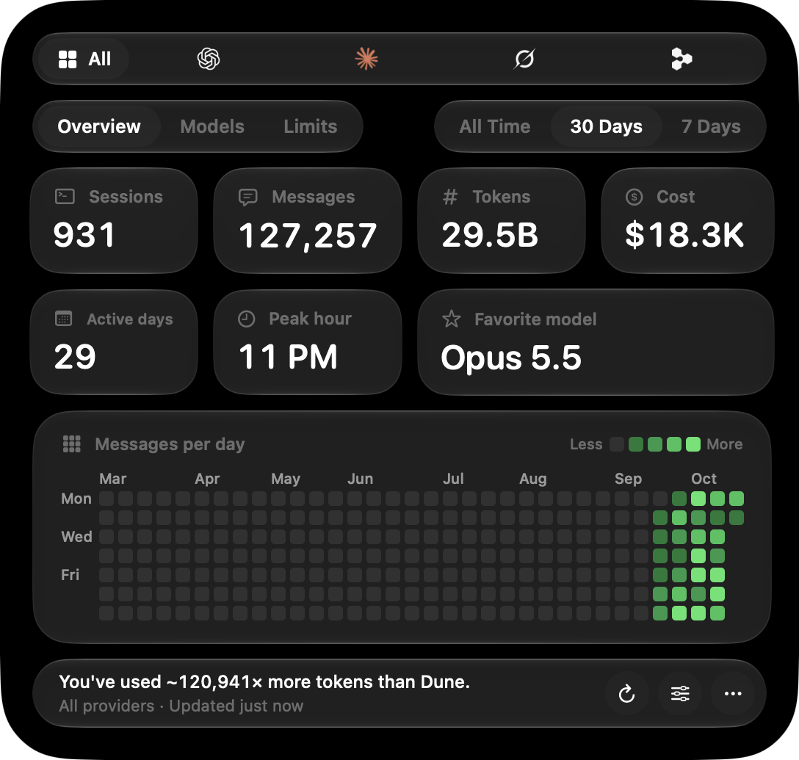
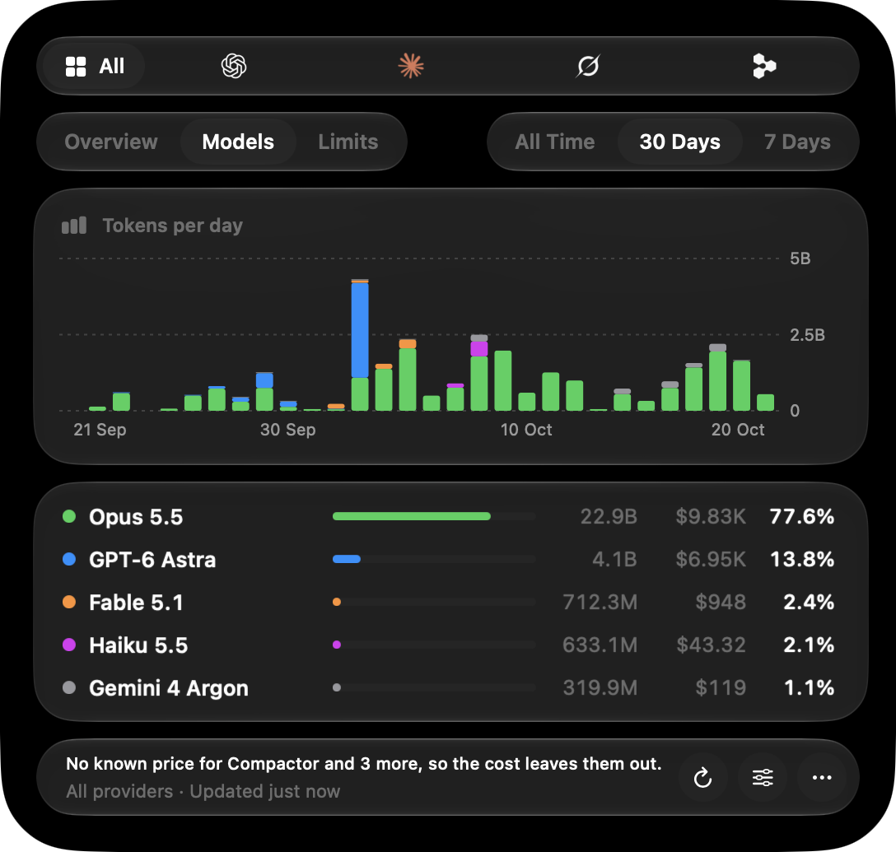
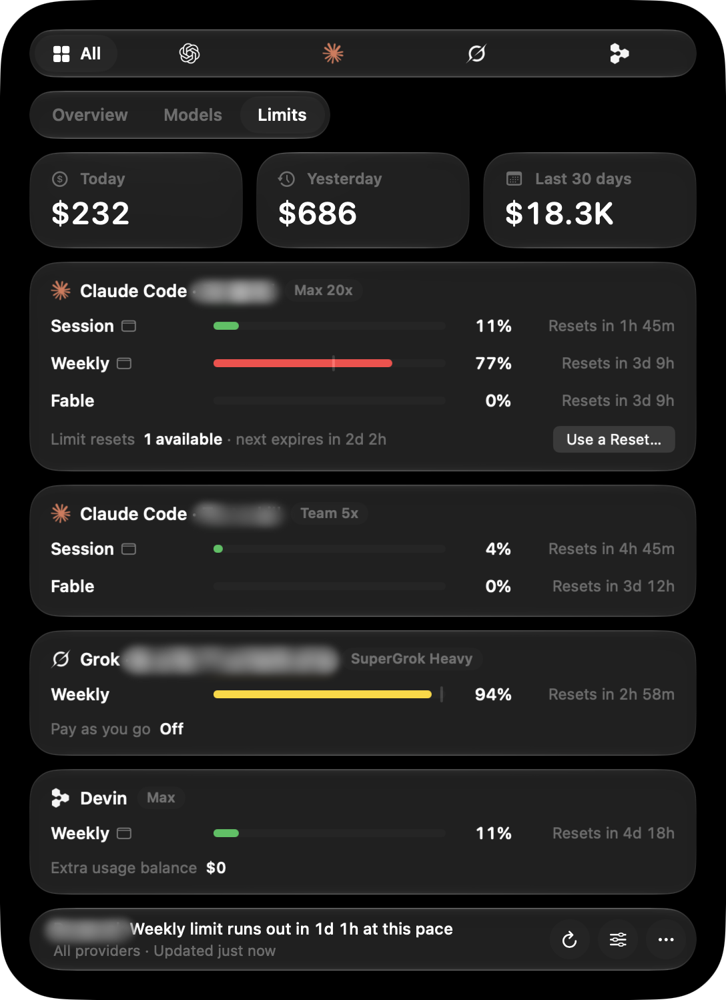

<picture>
  <source media="(prefers-color-scheme: dark)" srcset="brand/banner-dark.svg">
  
</picture>

<p align="center">
  Codex · Claude Code · Cursor · Grok · OpenCode · Antigravity · Muse Code · Pi · Devin
</p>

<p align="center">
  
</p>

SwiftUsage is a macOS menu bar app that shows your coding agents' usage: sessions, messages, total tokens, what those tokens would cost at API rates, active days, peak hour, favorite model, a GitHub-style activity heatmap, and a per-model breakdown for all time, the last 30 days, or the last 7 days. Pick one provider or see them all together.

Usage history is read locally from each tool's own files and never leaves your Mac. Two things come from the providers instead, each asked with the login its tool already keeps on this Mac: limits, from each provider's own usage API (see [Limits](#limits)), and Cursor's tokens, which only Cursor's servers keep.

SwiftUsage sends anonymous statistics to its developer: a daily check-in with the app's version and which providers are on and in use, crash reports, and, unless you turn it off in Customize → General, each day's count of panel openings and of limit readings that worked or failed. None of it names you or an account or says how much you used; [docs/privacy.md](docs/privacy.md) lists every field.

## Install

SwiftUsage needs macOS 26 or later, on Apple silicon or Intel. It runs natively on both and never uses Rosetta.

1. Download `SwiftUsage-<version>.dmg` from the [latest release](https://github.com/Blueemi/swiftusage/releases/latest).
2. Open it and drag SwiftUsage to Applications.
3. Open SwiftUsage from Applications. It has no Dock icon or window: it's the item in the menu bar, and clicking it opens the panel. Open at Login in the ⋯ menu starts it with your Mac.

The app is signed with a Developer ID and notarized by Apple; the first time it opens, macOS asks once whether to open an app downloaded from the internet.

SwiftUsage updates itself. Once a day it reads the latest release's `feed.json` from GitHub (the request carries nothing about your usage), downloads a newer version in the background, and then opens a window offering Install and Relaunch, Remind Me Later (asks again a day later) or Skip This Version. ⋯ → Check for Updates… looks right away, and Customize → General turns the daily check off. An update installs only if it's signed with the same Developer ID as the copy you have, notarized by Apple, the version the release names and newer; it replaces the app in one step and reopens it, and settings and the saved history carry over. A copy opened straight from the disk image or Downloads can't replace itself, so its window offers the download instead. You can always update by hand too: quit SwiftUsage (⋯ → Quit SwiftUsage) and drag the new version over the old one.

To uninstall, turn off Open at Login in the ⋯ menu, quit SwiftUsage, and move it from Applications to the Trash. Its own files stay behind until you delete them: `~/Library/Caches/dev.tasteskill.UsageGraphs/` holds the transcript summaries (history your coding agents have since deleted included), the last limits it read, the price list, Cursor's usage events, a downloaded update waiting to be installed, and which account each Claude Code, Antigravity, Pi and Cursor login belongs to (Antigravity's by email address), `~/Library/Application Support/dev.tasteskill.UsageGraphs/` holds pending reset requests and statistics waiting to be sent, and `defaults delete dev.tasteskill.UsageGraphs` clears its settings. Neither touches your coding agents' own history or logins.

## The panel

### Models

<p align="center">
  
</p>

The Models tab charts tokens per day, stacked by model, and lists each model's tokens, cost and share of the total. Its footer names any models no price list covers, which the cost leaves out.

### Plan limits

<p align="center">
  
</p>

The Limits tab shows each signed-in account's plan limits the way [OpenUsage](https://github.com/robinebers/openusage) does: session, weekly and per-model windows with their reset countdowns, bars colored by pace (green while you're on course to finish with room to spare, yellow when it'll be close, red when you'll run out before the reset), balances and credits, and what you spent today, yesterday and over the last 30 days.

### Menu bar

<p align="center">
  
</p>

Pinned limits sit in the menu bar after today's tokens and cost: each account's provider logo with the percentages of its pinned limits; hover the item to see which account is which. It starts out showing each Claude account's session and weekly limits; change them, or drag an account to another place along the preview, in Customize → Menu Bar. Right-click a limit in the Limits tab to show it in the menu bar.

### Customize

Customize (the sliders button, or ⌘,) picks what the app follows. Providers you turn off leave the picker, the totals and the menu bar, and their history and limits aren't read; accounts you turn off leave the Limits tab and the menu bar. Its Menu Bar page previews the item and sets what it shows: today's tokens and cost, which limits are pinned, in what order (drag an account along the preview to move it), and whether they read as used or left. Its General page sets how often the limits are read (every five minutes unless you change it, from one minute to an hour), whether the app opens at login, whether it checks for updates, and whether it sends the daily counts in Help Improve SwiftUsage (see [docs/privacy.md](docs/privacy.md)).

### Screenshot Mode

Screenshot Mode in the ⋯ menu puts the panel on a black pane until it closes, so screenshots show its glass over plain black rather than whatever windows and wallpaper are behind it. The screenshots here were taken with it, with account names blurred afterwards.

## Providers

| Provider | Read from |
| --- | --- |
| Codex | `$CODEX_HOME`, or else `~/.codex` and every other home (`~/.config/codex`, side-by-side homes such as `~/.codex-work`): `sessions/**/rollout-*.jsonl[.zst]` and `archived_sessions/` |
| Claude Code | `$CLAUDE_CONFIG_DIR`, or else `~/.claude` and every other config folder (`~/.claude*` such as `~/.claude_personal`, `~/.config/claude*`): `projects/*/*.jsonl` |
| Cursor | `~/.cursor/chats/*/*/store.db` (CLI) and Cursor's `state.vscdb` (IDE); tokens from Cursor's usage events |
| Grok | `$GROK_HOME` or `~/.grok`: `sessions/*/*/updates.jsonl` |
| OpenCode | `$OPENCODE_DATA_DIR` or `~/.local/share/opencode`: `opencode*.db` |
| Antigravity | `~/.gemini/antigravity*/conversations/*.db` |
| Muse Code | `~/.local/share/muse/sessions/**/session.jsonl` |
| Pi | `$PI_CODING_AGENT_DIR` or `~/.pi/agent`: `sessions/*/*.jsonl` |
| Devin | `~/.local/share/devin`: `cli/sessions.db` and `cli-next/sessions.db` |

The variables are read from the app's own environment. Opened from Finder or at login, it doesn't see ones set in a shell profile such as `~/.zshrc`, so it reads the default folder. For Claude Code and Codex that means every folder beside it too, and every folder `CLAUDE_CONFIG_DIR` or `CODEX_HOME` has named when the app was opened from a shell; a folder that's another's through a symlink is read once. `launchctl setenv CLAUDE_CONFIG_DIR ~/somewhere` passes one to apps opened after it, until you log out, and then only that folder is read.

Some history can't be counted:

- **Cursor** keeps token counts on its servers. Its chats and messages are counted on this Mac, and its tokens and their cost come from the usage events its dashboard lists, asked for with the login Cursor keeps (which is only read, never renewed) at most every five minutes: the whole history the first time, then the last two days, and kept in the cache folder. Until a login can read them, its tokens show as "–".
- **Antigravity** conversations from before its SQLite format are encrypted `.pb` files and are skipped.
- **Muse Code** wasn't installed when its reader was written, so the reader follows the usage events Muse's SDK reports and hasn't been checked against a real log.

## Limits

Each provider is asked for its limits every five minutes (Customize → General sets anything from one minute to an hour), just after a limit's window resets, when the panel opens (at most once a minute, or every 30 seconds at the one-minute setting) and whenever you click Refresh, with the login its tool already keeps; while it's being asked, the footer says so. Logins are only read, never changed, except a Claude Code login whose access token has run out, which is renewed and saved back the way Claude Code renews it, so the tools keep working exactly as before. When a login has expired, the card says which command renews it and keeps showing the last values it read.

| Provider | Login read from | Shows |
| --- | --- | --- |
| Codex | `auth.json` in `$CODEX_HOME`, `~/.codex`, `~/.config/codex` and side-by-side homes such as `~/.codex-work` | Session, Weekly (or Monthly on Free), Spark, credits, limit resets |
| Claude Code | the keychain (`Claude Code-credentials`) or `.credentials.json`, for `~/.claude` and every other config folder such as `~/.claude_personal`; then Claude Desktop's login for an account none of them has, or to fill in one whose reading failed | Session, Weekly, per-model weekly (Fable), extra usage, limit resets |
| Cursor | Cursor's `state.vscdb` | Included usage, Cursor and other models, on-demand; requests for team and enterprise plans |
| Grok | `~/.grok/auth.json` | Weekly pool, pay-as-you-go cap |
| OpenCode | OpenCode Go's key in `auth.json` or its database | Session, Weekly, Monthly |
| Antigravity | the app's and `agy`'s keychain items (`gemini`), and `agy`'s `~/.gemini/jetski-standalone-oauth-token` | Gemini and Claude pools, five-hour and weekly, and Argon's week |
| Pi | `~/.pi/agent/auth.json` | the Claude, ChatGPT and Grok subscriptions Pi is signed in to |
| Devin | `~/.local/share/devin/credentials.toml` | Daily and weekly quota, extra usage balance |

Each Claude login is its own card, named after its organization ("Personal" for the one Anthropic makes for each person). Claude Code's access tokens last eight hours, so the login of an account you haven't used since then has run out although Claude Code could still renew it. The app renews it as Claude Code does: Anthropic hands out a new refresh token each time and retires the old one, so the renewed login goes back where Claude Code keeps it (the keychain item, through `security` as Claude Code writes it, or `.credentials.json`), with everything else kept there as it was. It holds Claude Code's own locks while it does (`.oauth_refresh.lock` in the config folder and `<folder>.lock` beside it, then `.storage-write`), reads the login again once it has them in case Claude Code renewed it meanwhile, and doesn't save over a login signed in since. A login in use is left to Claude Code. An account several tools are signed in to (Pi on your Claude subscription, say) is one card, marked "Also used by Pi". Claude Desktop's login never gets a card of its own: an account Claude Code is signed in to as well stays that one card, and one only Desktop has is named like any other. Desktop keeps its login encrypted with a key macOS guards, so that account's card asks first: Allow Access… shows macOS's prompt once, and "Always Allow" keeps it silent after that. Antigravity's access tokens last an hour; a new one is fetched with the login's refresh token, which Google doesn't rotate, and kept in memory only. The app's login and `agy`'s for the same Google account are one card. Accounts on a paid plan get the summary of their shared pools; others, which Google turns away from that summary, get each model's quota pooled the same way. Muse Code's limits are per-minute rates on Meta's API, with nothing to read them from.

Codex and Claude hand out limit resets now and then, each of which refills the session and weekly limits at once (the monthly one on ChatGPT Free). The card shows how many an account has and when the next one lapses, and Use a Reset… spends one after you confirm, with the same request the Codex CLI and Claude Code send: Codex's first to lapse, or the Claude grant Anthropic names as next. Apart from renewing an expired Claude Code login, it's the only request the app makes that changes anything. Each one carries an ID the provider tells repeats apart by, and if its answer gets lost, trying again sends the same ID, even after the app restarts, so it can't use a second reset.

`swiftusage --limits` prints every account's limits in the terminal (`--provider <id>` for one), and `--limits --json` as JSON for scripts and agents:

```sh
/Applications/SwiftUsage.app/Contents/MacOS/swiftusage --limits --provider antigravity
```

## Build from source

Needs Xcode 26 or later (Swift 6.2) and macOS 26 or later.

```sh
./scripts/build-app.sh            # builds build/SwiftUsage.app, signed ad hoc for this Mac
./scripts/build-app.sh --install  # also copies it to /Applications and launches it
swift test                        # parser, incremental reading, stats, pricing and limits tests
```

A build from source sends no statistics (see [docs/privacy.md](docs/privacy.md)).

`swiftusage --dump` prints the panel's numbers for every provider in the terminal (`--provider codex` for one, `--cold` skips the saved indexes). `--dump --json` writes one provider's numbers per day as JSON, Claude Code's unless `--provider` names another; it's the report `scripts/verify.sh` checks. The terminal commands read the app's saved indexes but never write them.

```sh
/Applications/SwiftUsage.app/Contents/MacOS/swiftusage --dump --provider claude
```

### Releasing

`./scripts/release.sh` makes a release in `dist/`: `SwiftUsage-<version>.dmg` and `.zip`, built for Apple silicon and Intel, signed with the keychain's Developer ID Application certificate and the hardened runtime, notarized by Apple and stapled; their `SHA256SUMS`; the version's notes from `CHANGELOG.md`; the app's debug symbols, for reading crash reports; and `feed.json`, which installed copies read to update themselves: the version and build, the zip's address in the release, and its SHA-256 and size. The app reads the feed from the latest release on GitHub (`releases/latest/download/feed.json` under the `SwiftUsageReleases` address that `scripts/build-app.sh` puts in its Info.plist), so publishing a release is all it takes to update everyone. It runs the tests first, and checks everything else it needs before it builds. It lays out the disk image with [dmgbuild](https://github.com/dmgbuild/dmgbuild), which it runs through uv (`brew install uv`).

1. Set the version in `VERSION` and describe it under its own heading in `CHANGELOG.md` (`## <version>`, alone on its line). Commit everything: the build number counts commits, and the script stops when the working tree has uncommitted changes, so the release is exactly the commit it names.
2. Once on each Mac, save notarytool's credentials in the keychain as `swiftusage`. With an App Store Connect API key (Users and Access → Integrations → Team Keys, Developer role):

   ```sh
   xcrun notarytool store-credentials swiftusage --key AuthKey_<key ID>.p8 --key-id <key ID> --issuer <issuer ID>
   ```

   Or with an Apple Account and an app-specific password, `--apple-id <email> --team-id <team ID>`. `NOTARY_PROFILE` picks credentials saved under another name, and `SIGN_IDENTITY` another certificate.
3. Once on each Mac, install [posthog-cli](https://posthog.com/docs/cli) and sign it in to PostHog's EU cloud, which opens the browser to approve it:

   ```sh
   brew install posthog/tap/posthog-cli
   posthog-cli --host https://eu.posthog.com login
   ```

   The script uploads each release's debug symbols with it, so PostHog's crash reports name the functions a crash happened in; if the upload fails, the release still stands and the script prints the command to try again. The statistics go to the SwiftUsage project there, whose key is `bakedToken` in `Sources/UsageGraphs/Telemetry.swift`. Its settings keep exception autocapture on (Error tracking), without which PostHog drops the crash reports, and discard client IP data.
4. Run `./scripts/release.sh`. It builds in a temporary folder and replaces `dist/` only once everything succeeded, so a failed run leaves the last release as it was. Then push the commit it built (`dist/COMMIT`) and publish what it made, tagged on that commit:

   ```sh
   v=$(<VERSION)
   git push origin main
   gh release create v$v dist/SwiftUsage-$v.dmg dist/SwiftUsage-$v.zip dist/SHA256SUMS dist/feed.json \
       --target "$(<dist/COMMIT)" --title "SwiftUsage $v" --notes-file dist/SwiftUsage-$v-notes.md
   ```

   The feed points at the zip under the tag `v<version>`, so the release has to have that tag, and the zip and the feed have to be uploaded as they are. The repository has to be public for installed copies to read it.

`./scripts/release.sh --skip-notarization` makes the same files without notarizing them, to check the packaging, uncommitted changes and all; Gatekeeper turns those away on other Macs.

## How the numbers are counted

**Cost** is what the tokens would cost at API rates, not what a subscription bills. Each response is priced on its own, from LiteLLM's public [price list](https://github.com/BerriAI/litellm), with OpenUsage's pricing supplement for models the list doesn't carry yet. One-hour cache writes cost more than five-minute ones, a prompt past a model's long-context threshold moves the whole request to the higher rates, and fast modes (Claude Code's fast mode, Codex's priority tier) bill at their multiple. Where a tool logs what each response cost (Grok, Pi, OpenCode), that amount is used instead. Models no list can price, such as local models, are named in the Models tab and left out of the cost. The app ships with a copy of both lists (`./scripts/update-prices.sh` refreshes it) and fetches LiteLLM's list once a day; that request carries nothing about your usage.

The rules below are Claude Code's. The other providers follow them as closely as their history allows: tokens are split into uncached input, output (reasoning included), cache reads and cache writes, whatever each tool calls them; responses copied into forked or continued sessions count once; subagents add tokens but not sessions or messages.

- **Codex**: one response per `token_usage_record`, or else per `token_count` event that isn't a repeat. Forked and subagent rollouts start by replaying their parent's turns, which are recognized by their older turn IDs and skipped.
- **Grok** logs usage per turn, not per response, so each model call in a turn counts as a reply.
- **OpenCode** reported reasoning tokens inside or beside output depending on its version and the model's provider; the recorded total tells which.
- **Pi** and **Antigravity** record usage per response.
- **Devin** copies messages into new rows as a session's history is rewritten, so each message counts once by its ID. Only prompts you typed count as your messages, not context Devin adds as user messages. Its hidden background sessions add tokens but not sessions.
- Models are grouped by name, without the reasoning effort tools add to their IDs, so Opus 5.5 is one row whether Claude Code, Devin or OpenCode ran it.

Claude Code:

- **Tokens**: input, output, cache reads and cache writes from every response, subagents included, counted once per response by its `message.id`. Claude Code writes a response once per content block. Earlier lines carry partial output counts, and occasionally extra lines with the usage zeroed are appended, so the largest usage seen for a response is the one counted. Claude Code's own `/stats` adds up every line and shows roughly twice as many tokens.
- **Messages**: your prompts and tool results (user entries, by `uuid`) plus Claude's replies (by `message.id`) on the main thread. Each counts once, even when Claude Code writes the same entry twice or copies history into a continued or forked session. Claude Code's local `<synthetic>` notices (API errors, interruptions) aren't replies and don't count.
- **Sessions**: main session transcripts, dated by their first entry. A transcript whose messages all live in a larger one is a copy (for example the original of a continued session) and doesn't count again. A fork that has its own new messages counts as its own session.
- **Active days / peak hour**: days with any activity, and the hour of day in which most sessions started, both in your local time zone.
- **Heatmap**: the last 34 weeks, one column per week, shaded by messages per day. Shades follow the quartiles of your active days in view, as on GitHub.

Transcripts don't record everything. Claude Code also keeps a per-session running total, and on finished sessions the transcripts account for about 98.5% of it. The rest is background calls it never writes to the transcript (compaction-style requests and a small Haiku call for titles). That total has no timestamps and gets copied into forks, so it can't be placed on a day and isn't included. The other way round, responses cut off mid-stream appear in transcripts but not in that total. Their input was still processed, so they are counted.

## Checking the numbers

```sh
./scripts/verify.sh
```

This checks Claude Code's numbers. It takes an APFS clone of your transcripts (instant, no extra disk space) and compares the app with `scripts/verify/reference.py`, a separate Python implementation of the rules above that fully parses every line. It compares sessions, messages and each model's four token counts per day. It then rebuilds every transcript in random chunks that split lines, refreshing and reloading the saved index along the way, and checks that this matches the reference too.

## How it stays fast

The first scan reads every transcript in parallel (about 30 seconds for 31 GB of Codex rollouts). For Claude Code, a byte-level JSON reader pulls out only the fields it needs and skips large tool results with `memchr`; for the other JSONL formats, lines are checked for a marker before they're parsed. After that, the app keeps a summary of each transcript in `~/Library/Caches/dev.tasteskill.UsageGraphs/` and an FSEvents watcher reads only the bytes appended since the last pass, for only the provider whose files changed. SQLite histories are re-read only when the database or its WAL changes (OpenCode only the rows updated since the last read), opened immutable or read-only so no `-wal`/`-shm` files are left beside another app's database.

Claude Code deletes transcripts after 30 days by default (`cleanupPeriodDays`). The index keeps summaries of deleted transcripts, so "All" keeps counting history that Claude Code no longer has; the same goes for Codex, Grok, Muse Code and Pi. "Re-read All History" in the ⋯ menu discards the indexes and starts again from what's on disk.

## Brand

The name, mark, logo, app icon, colors and type are in the [brand kit](brand/).

## Author

SwiftUsage is made by [@blueemi99](https://x.com/blueemi99). Follow along on X for updates and what's next.

## License

SwiftUsage is under the [MIT License](LICENSE).

## Notices

The price lists the app ships with come from LiteLLM and OpenUsage, under the MIT License, and it includes zstd's decoder and PostHog's SDK; [THIRD-PARTY-NOTICES.md](THIRD-PARTY-NOTICES.md) has their licenses, and the app carries a copy. Provider names and logos belong to their owners, and SwiftUsage isn't affiliated with any of them.
