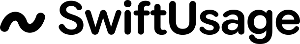
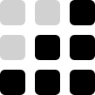
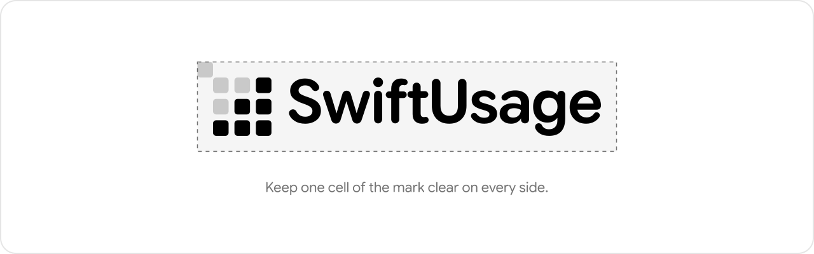
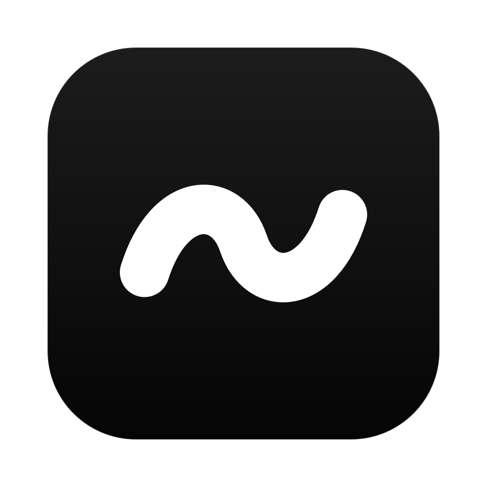
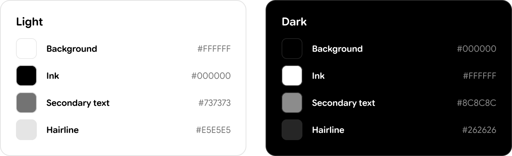
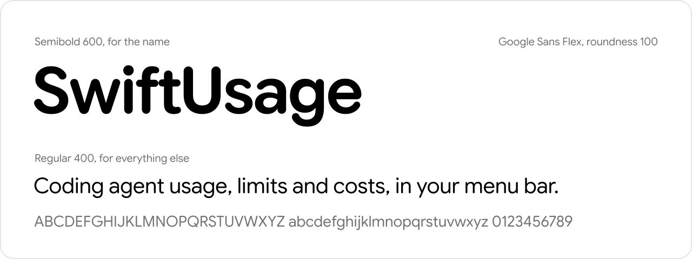

  <picture>
    <source media="(prefers-color-scheme: dark)" srcset="logo-white.svg">
    
  </picture>

<h1 align="center">Brand kit</h1>

SwiftUsage's name, mark, logo, app icon, colors and type, and how to use them.

## Name

**SwiftUsage**: one word with a capital S and a capital U, like SwiftUI. Not swiftusage, Swiftusage, Swift Usage or SWIFTUSAGE. Only the command is lowercase: `swiftusage`.

## Mark

  <picture>
    <source media="(prefers-color-scheme: dark)" srcset="mark-white.svg">
    
  </picture>

A tilde. The app's numbers are estimates (~$18.3K, ~120,941× more tokens than Dune), and ~ is how you say so honestly. It's also an S lying on its side, and home in a terminal.

- One stroke with round caps, 24 wide on a 120 grid. Its path runs from (12, 74) to (108, 46) through the center, with its control points at (24, 36), (52, 36), (68, 84) and (96, 84). It turns about the center, so its two halves are the same shape.
- The caps reach the grid's sides; `mark.svg` keeps the full square so it fits avatars and favicons as is.
- The 16pt menu bar icon draws it with a 2.6pt stroke, a little lighter than the logo's, so it sits with the menu bar's other icons.

## Logo

The mark, then the name. The mark is as wide as the name is tall (from the dot of the i to the bottom of the g), 30% of that away, and centered on the x-height, where a typeset ~ sits.

<picture>
  <source media="(prefers-color-scheme: dark)" srcset="clear-space-dark.svg">
  
</picture>

- Keep at least the height of the mark clear around the logo.
- Use the white versions on dark backgrounds rather than inverting the black ones.
- Don't recolor, outline, stretch, rotate or add effects to the mark or the name.

## App icon

The white mark on a black squircle, 520 wide on Apple's 1024 grid. The build draws it with `scripts/make-icon.swift`, and the app draws the menu bar icon in `MenuBarIcon`.

## Color

Black and white only. Gray is for secondary text and hairlines, never for the mark or the name.

| | Light | Dark |
| --- | --- | --- |
| Background | `#FFFFFF` | `#000000` |
| Ink | `#000000` | `#FFFFFF` |
| Secondary text | `#737373` | `#8C8C8C` |
| Hairline | `#E5E5E5` | `#262626` |

The app's greens, yellows and reds are data colors (heat, pace), not brand colors.

## Type

<picture>
  <source media="(prefers-color-scheme: dark)" srcset="type-dark.svg">
  
</picture>

[Google Sans Flex](https://github.com/googlefonts/googlesans-flex) at full roundness (SIL Open Font License, in `fonts/`), the closest open font to the SF Pro Rounded the app sets its numbers in. SF Pro itself can't be used: Apple's license only covers interface mockups, not logos or artwork. The name is set in Semibold (600) at the font's own spacing, with ligatures off so the f and t stay apart, never tracked or split into weights. Taglines and other text are Regular (400).

## Files

| File | Use |
| --- | --- |
| `mark.svg`, `mark-white.svg` | The mark alone: avatars, favicons, small spaces |
| `logo.svg`, `logo-white.svg` | The mark and the name |
| `icon.png` | The app icon, 1024×1024 |
| `banner-light.svg`, `banner-dark.svg` | The README's banner, swapped with GitHub's appearance |
| `social.png` | GitHub's social preview, 1280×640 (Settings → Social preview) |
| `palette.svg`, `type-*.svg`, `clear-space-*.svg` | The sheets on this page |
| `fonts/` | Google Sans Flex with its roundness fixed at 100 and cut to Latin (weight and optical size still variable), with its license |

`swift scripts/make-brand.swift` regenerates the SVGs and `social.png` from the fonts here. They carry the letters as outlines, so they show the same without the font installed. `icon.png` is `icon_512x512@2x.png` from `swift scripts/make-icon.swift <folder>.iconset`.
